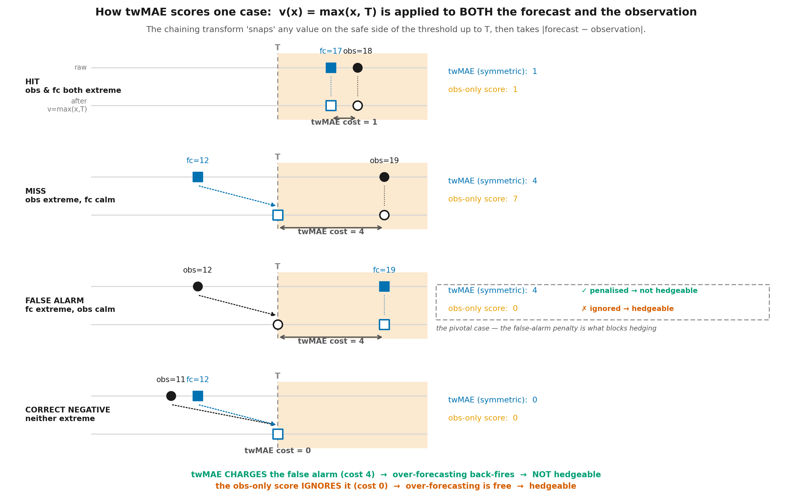
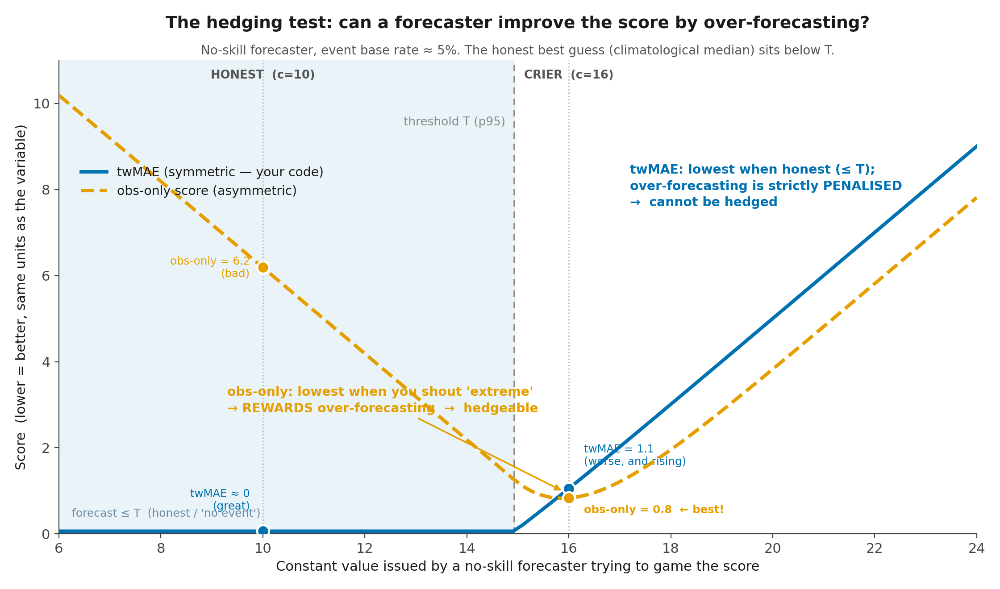

# Is twMAE hedgeable?

**Short answer: no — not as it is computed in this tool.** The threshold-weighted MAE
implemented in [`src/det_scores.py`](../src/det_scores.py) applies the chaining
transform `v(x) = max(x, T)` (upper tail; `min(x, T)` for the lower tail) to **both**
the forecast and the observation, using the **same** threshold `T` for both. Because of
that symmetry it **penalises false alarms**, and that penalty is exactly what makes the
score impossible to game by over-forecasting.

A tail-focused score is only hedgeable if it **fails to penalise false alarms** — i.e.
if it keys off the observation only ("was the observation extreme?") and never charges
the forecast for crying wolf. That is the classic *Forecaster's Dilemma* (Lerch et al.
2017), and it is a real concern — but it describes the **obs-only** construction, not
the symmetric chaining twMAE used here.

---

## Definition of hedging (from the literature)

> **"Hedging is said to occur whenever a forecaster's judgment and forecast differ."**
> — the classic formulation, after **Murphy & Epstein (1967)** and **Murphy (1978)**,
> *Hedging and the mode of expression of weather forecasts* (Bull. Amer. Meteor. Soc.,
> 59, 371–373). Hedging only matters if it *pays*: it is beneficial to the forecaster
> only when it improves the **expected (long-run) value** of the score.

Stated in terms of propriety — **Jolliffe (2008)**, *The impenetrable hedge*,
Meteorological Applications, **15, 25–29 (p. 25)**: hedging is *"to issue a forecast that
differs from his or her 'true belief' or 'judgment' in order to improve either the score
that is being used to assess the forecast, or its expectation,"* and *"it is generally
accepted that it is undesirable to use a score for which hedging can improve the score or
its expected value."* A **proper** score is, by definition, one that **cannot be hedged**
(Gneiting & Raftery 2007).

This is the sense used throughout this note: "is twMAE hedgeable?" means "can a forecaster
improve their expected twMAE by reporting something other than their true judgment —
specifically, by over-forecasting?" Figure 2 answers it: no.

---

## The exact criterion

> **Hedgeable ⟺ false alarms are not penalised.**

Hedging means *improving your score by distorting your forecast* (here: systematically
over-forecasting to catch more extremes). You can only profit from that if the extra
false alarms you create are **free**. twMAE makes them cost `fc − T > 0`, so the gain
from catching real extremes is cancelled by the cost of the false alarms — no net gain,
no incentive to hedge.

Analogy: a multiple-choice exam **with negative marking** can't be gamed by wild
guessing; **without negative marking** you should guess "extreme!" on everything. The
false-alarm penalty *is* the negative marking.

---

## What the code actually does

[`src/det_scores.py`](../src/det_scores.py), `calculate_twmae()` — the forecast and the
observation are treated **identically**:

```python
if event_type == 'above':
    fc_v  = np.maximum(forecast,    threshold)   # forecast
    obs_v = np.maximum(observation, threshold)   # observation — same transform, same T
return float(np.mean(np.abs(fc_v - obs_v)))
```

This is Taggart's (2022) consistent scoring function for the threshold-weighted **median**
(equivalently, the deterministic/single-valued case of the threshold-weighted CRPS). The
false-alarm term is non-zero and shows up explicitly in the `twMAE_FA` component of the
decomposition — proof that false alarms are charged.

---

## Figure 1 — the mechanism (one case at a time)



Four case types on a value line (threshold `T = 15`). Each shows the raw forecast/obs,
how `v(x) = max(x, T)` snaps safe-side values up to `T`, and the resulting cost — with
the **twMAE** cost beside the **obs-only** cost:

| case | twMAE (symmetric) | obs-only (asymmetric) |
|---|---|---|
| Hit (obs 18, fc 17) | 1 | 1 |
| Miss (obs 19, fc 12) | 4 | 7 |
| **False alarm (obs 12, fc 19)** | **4 ✓ penalised → not hedgeable** | **0 ✗ ignored → hedgeable** |
| Correct negative (obs 11, fc 12) | 0 | 0 |

Only the false-alarm row differs, and that one difference *is* the whole hedging
question: twMAE charges the false alarm (4), the obs-only score gives it a free pass (0).
**The penalty is the safeguard, not the loophole** — the loophole is its absence.

---

## Figure 2 — the consequence (the hedging test)



A no-skill forecaster issues a single constant value and sweeps it, trying to game the
score (observation climatology N(10, 3), threshold `T = p95 ≈ 14.9`, event rate ≈ 5 %):

- **twMAE (this tool)** is minimised by forecasting *at or below* `T`, and rises steeply
  the moment you over-forecast. Over-forecasting is **strictly penalised → cannot be
  hedged.**
- **obs-only score** is minimised by forecasting *into the tail* (best near `c ≈ 16`):
  it **rewards** over-forecasting → **hedgeable.**

The ranking of an **Honest** forecaster vs a **Crier** flips between the two scores —
that flip is the Forecaster's Dilemma, and it shows precisely when twMAE *would* be
hedgeable (only if computed the obs-only way).

| forecaster | twMAE (this tool) | obs-only score |
|---|---|---|
| Honest (reports climatological median, below T) | ≈ 0 (best) | 6.2 (bad) |
| Crier (always shouts "extreme") | 1.1 and rising (bad) | 0.8 (best) |

---

## The one thing to confirm

The symmetric chaining twMAE in this repo is not hedgeable. The **only** change that
would reintroduce the loophole is to compute twMAE on an **`obs ≥ T` subset** (observed
extremes only), which removes the false-alarm penalty. Confirm that no part of the
pipeline — including any external/operational precipitation verification — does that.

---

## A separate caveat (do not confuse with hedging)

twMAE is only **weakly** consistent in the tail: because `v(x) = max(x, T)` is flat below
`T`, *any* forecast on the safe side of the threshold scores the same (see the flat part
of the twMAE curve in Figure 2). So the score **cannot distinguish two different
under-forecasts** below `T`. This is a real limitation — it means a twMAE difference
between two chronically under-forecasting models is driven only by the few cases that
cross `T` (small effective sample) — but it is **not** hedgeability: it gives no
incentive to lie, and over-forecasting is still strictly penalised. If the concern is
"it can't tell my two models apart," pair twMAE with **twRMSE** (consistent for the
mean) and inspect the `twMAE_misses` / `count_misses_pct` diagnostics.

---

## References

- **Murphy, A. H., & Epstein, E. S.** (1967). Verification of probabilistic predictions:
  A brief review. *J. Appl. Meteor.*, 6, 748–755. — and **Murphy, A. H.** (1978).
  Hedging and the mode of expression of weather forecasts. *Bull. Amer. Meteor. Soc.*,
  59(4), 371–373. — origin of the definition "hedging occurs whenever a forecaster's
  judgment and forecast differ." See also the WWRP/WGNE verification FAQ:
  <https://www.cawcr.gov.au/projects/verification/FAQ-Hedging2.html>
- **Jolliffe, I. T.** (2008). The impenetrable hedge: a note on propriety, equitability
  and consistency. *Meteorological Applications*, 15(1), 25–29 (definition on p. 25).
- **Gneiting, T., & Raftery, A. E.** (2007). Strictly proper scoring rules, prediction,
  and estimation. *JASA*, 102(477), 359–378. — a proper score is one that cannot be
  hedged. <https://doi.org/10.1198/016214506000001437>
- **Taggart, R. J.** (2022). Evaluation of point forecasts for extreme events using
  consistent scoring functions. *QJRMS*, 148(742), 306–320.
  <https://doi.org/10.1002/qj.4206> (arXiv: <https://arxiv.org/abs/2102.00577>) —
  the theoretical home of twMAE (threshold-weighted consistent scoring function for the
  median).
- **Gneiting, T.** (2011). Making and evaluating point forecasts. *JASA*, 106(494),
  746–762. <https://arxiv.org/abs/0912.0902> — MAE is consistent for the median; name
  the target functional, then pick a consistent score.
- **Lerch, S., Thorarinsdottir, T. L., Ravazzolo, F., Gneiting, T.** (2017). The
  Forecaster's Dilemma: Extreme events and forecast evaluation. *Statistical Science*,
  32(1), 106–127. <https://arxiv.org/abs/1512.09244> — why scoring on observed extremes
  only is hedgeable.
- **Allen, S., Ginsbourger, D., Ziegel, J.** (2023). Evaluating forecasts for
  high-impact events using transformed kernel scores. *SIAM/ASA JUQ*, 11(3), 906–940.
  <https://arxiv.org/abs/2202.12732> — the chaining-function view (`v(z) = max(z, t)`;
  twCRPS = ordinary CRPS on transformed values).

---

## Reproduce the figures

```bash
.venv/bin/python docs/figures/make_twmae_figs.py
```

Figures and the generating script live in [`docs/figures/`](figures/). The script
imports the repo's own `src/det_scores.calculate_twmae`, so the numbers in the figures
are produced by the exact function used in the scorecards.
